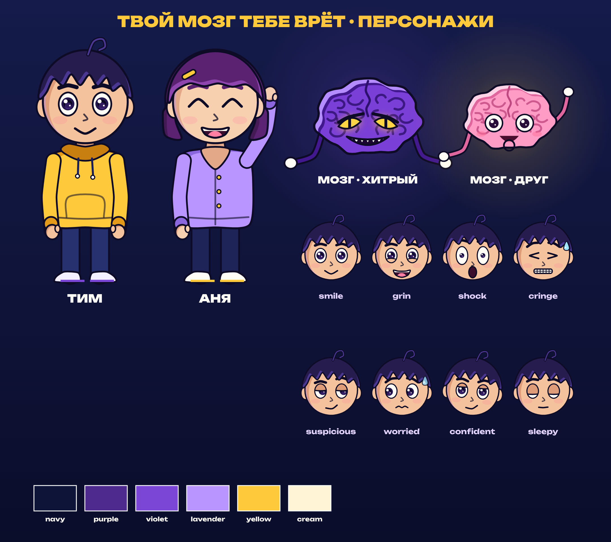

# Characters — «Твой мозг тебе врёт»

All characters are code rigs in [`video/lib/characters.js`](../video/lib/characters.js): flat fills, a 7 px ink outline that "boils" 12× per second (seeded, so every render is identical), a cel shadow and a lavender rim light. Reuse them in any HyperFrames scene by loading `lib/core.js` + `lib/characters.js` and calling the draw functions on a canvas from the scene's timeline.

## Tim (Тим) — protagonist

- Young man, big round head (~2/5 of his 810 px height), signature **curl** on top of messy navy-purple hair.
- **Yellow hoodie** `#FFC93C` with navy drawstrings and a kangaroo pocket, navy jeans `#27316F`, white sneakers with violet soles.
- Large eyes with violet-black irises and two highlights; thick ink brows.
- `CHAR.drawHuman(ctx, { st: CHAR.TIM, x, y, s, ... }, t)` — full body (origin at the feet).
- `CHAR.drawFace(ctx, { st: CHAR.TIM, x, y, s, ... }, t)` — head only (origin at the head centre).

## Anya (Аня) — the second witness (scene 5)

- Plum bob haircut with a **yellow hair clip**, lavender cardigan `#B996FF` with yellow buttons, lash flicks.
- Same rig: `{ st: CHAR.ANYA, ... }`.

## The Brain (Мозг)

- A two-hemisphere brain with curly folds, little noodle arms and white cartoon gloves.
- `mood: 0` — **sinister**: violet `#7A3FD6`, glowing yellow slit eyes, sharp grin, purple aura.
- `mood: 1` — **friendly**: pink `#FF9CC6`, round eyes, blush, small smile, warm aura. (Scene 6 turns 0 → 1 through a sparkle poof.)
- `CHAR.drawBrain(ctx, { x, y, s, mood, look, open, mouth, mouthOpen, armL, armR, arms, glow }, t)` returns the world positions of its hands (used for puppet strings via `CHAR.string`).

## Expression controls (human rig)

| Parameter | Range / values | Use |
| --- | --- | --- |
| `look` | `[x, y]` −1…1 | where the eyes point |
| `turn` | −1…1 | slides the face sideways (3/4 view) |
| `lid`, `blink` | 0…1 | suspicious / sleepy lids, blinks |
| `eyeOpen`, `pupil` | ~0.6…1.4 | wide-eyed shock, tiny pupils |
| `eyes` | `normal`, `happy` (^ ^), `shut` (> <), `dots` | special eye shapes |
| `browL`, `browR`, `brow` | raise −1…1, `brow` −1 angry … +1 worried | |
| `mouth` | `smile`, `grin`, `open`, `o`, `flat`, `frown`, `smirk`, `cringe`, `wavy` | with `mouthOpen`, `smile` |
| `armL`, `armR` | `[shoulder, elbow]` radians | 0 = hanging; + = outward / forward |
| `propL`, `propR` | `(ctx, side, forearmAngle) => {}` | draws a prop in the hand |
| `sweat`, `blush`, `squash`, `headTilt`, `legs: "walk"` | | acting extras |

## Palette

| Token | Hex | Role |
| --- | --- | --- |
| navy | `#0E1338` / `#070A1F` | night, backgrounds |
| purple | `#4E2A8E` | depth, the brain's shadow |
| violet | `#7B45D6` | the brain, accents |
| lavender | `#B996FF` | rim light, Anya |
| yellow | `#FFC93C` | Tim, key words, highlights |
| cream | `#FFF4D6` | cards, light |

Type: **Unbounded** 500/700/900 (display) and **Montserrat** 600/800/900 (subtitles), Cyrillic subsets vendored in `video/assets/fonts` (SIL OFL).
